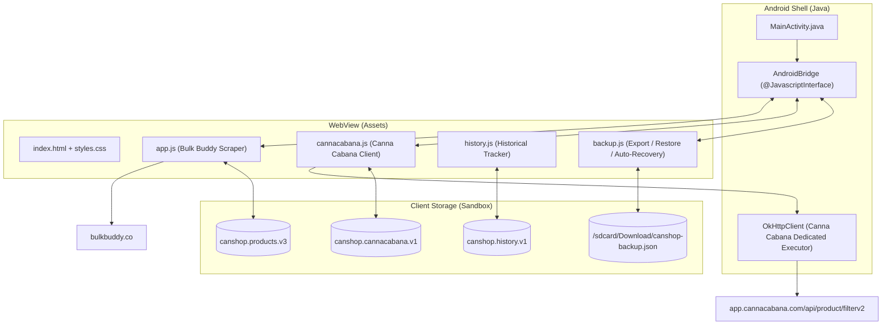

# CannabisShopper Developer & Architectural Manual

This skill documents the complete architecture, storage schemas, APK signing rules, and sourcing runbooks for CannabisShopper (`ca.canshop.app`).

---

## 1. System Architecture

CannabisShopper is an offline-capable, high-performance hybrid Android application pairing a modern web frontend with a secure Android native shell.



### Components
1. **Host (`app/src/main/java/ca/canshop/app/MainActivity.java`)**:
   - Manages Android `WebView` with hardware acceleration.
   - Hosts `AndroidBridge` exposed to JavaScript as `window.Android`.
   - Uses a dedicated single-threaded executor (`cannaExecutor`) and `OkHttpClient` (`cannaHttpClient`) for Canna Cabana API calls to prevent Bulk Buddy HTML fetches from starving API requests.
2. **Frontend UI (`app/src/main/assets/`)**:
   - `index.html`: Responsive single-page interface with tab navigation (Home, Strains, Filters, Trends).
   - `cannacabana.js`: Query engine, normalizer, and card renderer for Store 3658 inventory.
   - `app.js`: Bulk Buddy scraper, product scoring, and cross-source comparisons.
   - `history.js`: Trend tracker, price changes, reappearance logs, and strain lifespans.
   - `backup.js`: Envelope serialization, clipboard export, and disk auto-recovery.

---

## 2. Inviolable Invariants

### Data Preservation Invariant
- **The user's historical dataset is sacred.**
- Never propose uninstallation or clearing data to resolve install conflicts.
- Never create duplicate package IDs (e.g. `ca.canshop.app.v2`). The package ID MUST remain `ca.canshop.app`.
- Always verify data preservation with automated recovery (`checkLocalBackupFile`).

### In-Place Update Invariant
- All releases MUST be signed with the unified release keystore (`canshop-release.jks`).
- Updates MUST install seamlessly via:
  ```bash
  adb install -r CanShop-v<version>.apk
  ```
  without requiring uninstalls or data re-entry.

### Tool Autonomy
- Do not ask the user to copy or screenshot dense multi-day data.
- Connect directly to the WebView remote devtools socket:
  ```bash
  adb forward tcp:9222 localabstract:webview_devtools_remote_<PID>
  ```
  and inspect DOM/localStorage or evaluate JavaScript via Chrome DevTools Protocol.

---

## 3. Storage Schemas & Lifecycles

CanShop persists three primary keys in `localStorage`:

### A. Bulk Buddy Products: `canshop.products.v3`
Array of scraped Bulk Buddy flower entries:
```typescript
interface BulkBuddyProduct {
  id: string;
  title: string;
  url: string;
  price: number;
  regularPrice: number | null;
  salePrice: number | null;
  packageGrams: number;
  pricePerGram: number;
  thcPercent: number | null;
  strainType: 'Indica' | 'Sativa' | 'Hybrid';
  craft: boolean;
  score: number;
  inStock: boolean;
}
```

### B. Canna Cabana Strains: `canshop.cannacabana.v1`
Array of qualified Canna Cabana strains from Store 3658:
```typescript
interface CannaCabanaProduct {
  id: string;
  title: string;
  url: string;
  price: number;            // Elite price if available, otherwise Member price
  elitePrice: number | null;
  memberPrice: number;
  retailPrice: number;
  hasElite: boolean;        // true if active elite pricing exists
  priceType: 'Elite' | 'Regular';
  sizeGrams: number;        // Between 14.0 and 28.0 grams
  pricePerGram: number;     // price / sizeGrams
  thcPercent: number;       // >= 29.0%
  inStock: boolean;
}
```

### C. History & Trends: `canshop.history.v1`
Historical snapshots tracked by date (`YYYY-MM-DD`):
```typescript
interface HistoryDatabase {
  snapshots: Array<{
    date: string;
    productsCount: number;
    cannaCount: number;
    items: Array<SnapshotItem>;
  }>;
  strains: Record<string, {
    firstSeen: string;
    lastSeen: string;
    appearances: number;
    priceHistory: Array<{ date: string; price: number; pricePerGram: number }>;
  }>;
}
```

---

## 4. Canna Cabana Sourcing Runbook

### Query Configuration
- **Origin**: `https://app.cannacabana.com`
- **Endpoint**: `/api/product/filterv2`
- **Mandatory Parameters**:
  - `collection=whole-flower`
  - `storeId=3658`
  - `thc_level_min=29`
  - `thc_level_max=100`
  - `limit=100`

### Sizing Invariant
- Package sizes must fall between **14g and 28g** inclusive:
  $$13.9 \le \text{grams} \le 28.1$$
- Intermediate sizes (e.g. 15g) are explicitly supported. Sizes $<14\text{g}$ (such as 3.5g, 7g) or $>28\text{g}$ are excluded.

### Strict Sorting Invariant
When rendering or scoring Canna Cabana items:
1. **Tier 1 (Elites)**: All strains with active Elite pricing (`hasElite: true`) are displayed first, marked with a gold badge:
   `CANNA CABANA · ELITE`.
2. **Tier 2 (Regular)**: All qualifying strains with regular member pricing (`hasElite: false`) follow, marked with a blue badge:
   `CANNA CABANA · REGULAR`.
3. **Within Tier Sorting**:
   - Lowest price per gram ($\$/\text{g}$) ascending.
   - Highest THC percentage descending.
   - Alphabetical product title ascending.

---

## 5. Build, Test & Release Runbooks

### Unit Tests
Run the comprehensive test suite with Node's native test runner:
```bash
npm test
```
All 28+ test specifications must pass without regressions:
- Backup envelope parsing and serialization.
- Canna Cabana URL query parameter enforcement.
- Sizing boundaries (14g, 15g, 28g accepted; 3.5g, 7g rejected).
- THC threshold ($\ge 29\%$).
- Elite price vs. Regular member pricing resolution.
- Out-of-stock item rejection.

### Release Build Workflow
1. Increment version in `package.json` and `app/build.gradle`.
2. Commit and push to `main`.
3. GitHub Actions workflow (`android-apk.yml`) compiles, signs with `canshop-release.jks`, and attaches `CanShop-v<version>.apk` to the GitHub release.
4. Download and install in-place via ADB:
   ```bash
   adb install -r CanShop-v<version>.apk
   ```
